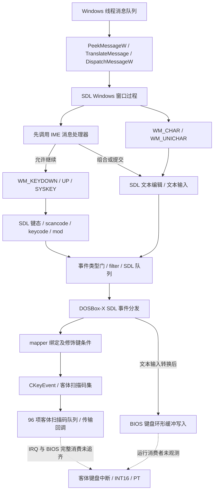

# 固定 DOSBox-X 的 Windows／SDL／DOS 输入静态链

本报告补充 [EX-003](exploration-backlog.md#ex-003) 的输入事件子问题。固定 PE 中已定位 Windows 消息泵、SDL 按键／文本／IME 分流、SDL 入队条件、DOSBox-X mapper、客体扫描码队列，以及文本直接写 BIOS 键盘缓冲区的入口。**这些代码支持按层区分 Shift+I、普通 Unicode 字母与命名 Enter／Up；不能恢复旧现场实际消息、证明绕过 IME，或把第八有限成功推广为全部输入条件成立。**

本次只有离线静态分析；没有运行 DOSBox-X／PT、控制服务、GUI、输入探针、窗口查询、截图、键鼠或输入法切换。沿用[原 AST／假 API 结论](native-menu-calibration.md#shortcut-offline-semantics)，没有重做16项测试／23次假回放或 PT 菜单逆向。EX-003 与原现场 Task 仍未闭环。

<a id="scope-and-inputs"></a>

## 输入、身份和证据范围

- 子任务：`task_e42e49c40a7d`／`ctx_91b6f0840e5a`；独立分支 `research/input-event-static`；只维护本报告。
- 实际 Pi：`01a1d35d-8022-7429-a399-06a4a1892e2e`，环境四字段及原 JSONL 的 `model_change`／`thinking_level_change` 为 `deng/gpt-6.1-sol/high`，并有成功工具回执。原 JSONL：`C:/Users/rikideng/.pi/agent/sessions/--C--Users-rikideng-orca-workspaces-pt_renew-input-chain--/2026-11-13T05-24-42-658Z_01a1d35d-8022-7429-a399-06a4a1892e2e.jsonl`；活动记录只按读取边界成立，不以未来全文件 SHA 不同判污染。
- 已完整读取 AGENTS、HANDOFF、探索规则、`main-2/.local-analysis/WORKTREE_CLEANUP_NOTICE.md` 与事项全部来源段落；首次盘点状态消息 `msg_b4303d844e22`。协调已在共享 dev `6c18d3e`／`63a1fc6` 登记领取和实际身份，回执后才深入研究。
- 目标：`C:/Users/rikideng/scoop/apps/dosbox-x/2026.10.01/dosbox-x.exe`，25836544 字节，SHA-256 `a82adcfa7af2784566cfeff74c077cefed08505396db2948b7e6aa7d4cee0832`，首选映像基址 `0x140000000`。版本／Commit 字符串为 `2026.10.01 / b6abbd5`；没有用未取得的同 commit 源码替代固定机器码。
- 旧 PT SHA `abc56e2e8467e608c68a0ddf0b0705e8270c5c60f83f193fa991f10293ece968` 只按既有菜单报告引用，本次没有重新读取或推导 PT 分段地址。
- 本树证据根：`C:/Users/rikideng/orca/workspaces/pt_renew/input-chain/.local-analysis/input-chain/`。`identity-and-inputs.json` 记录身份、目标、缓存摘要及工具版本；`verified-chain-v2.json` 记录原字节、映射、消息表、mapper 构造点和本轮核验；`r2-crosscheck-v2.json` 保存独立解码的命令／返回／stderr／原指令。

复用 `explore-ex001-observer/.local-analysis/ex-005-config-source/` 的 `E-triage-imports`（692 导入）、PE 节／字符串缓存。缓存仅作定位入口，关键结论均回到本目标原字节。原 `triage-evidence.json` 的旧单字段 Capstone 版本标法不作为本报告版本依据；本次实际分字段记录 module **5.0.7**、distribution **5.0.9**、native API **(5,0,1280)**，r2／rabin2 为 **6.2.6**。原导入缓存 SHA 为 `b185221d1cbe63fb031c94cb0fd0653995a71da83ab7f3efdeda935a1ff33294`；完整分类与复现命令沿原 Evidence 保留。

应用 radare2 技能；其引用的 `precedent-reverse.md` 与 `tool-index.md` 均不存在，按本任务覆盖记录缺失、不 bootstrap。REA／Ghidra／JDK 的已知版本门不重复诊断或安装。只将已有 `inspect_config_pe.py` 小工具复制并参数化为本树 `inspect_input_pe.py`：缓存读原树绝对路径，输出只写本证据根；不运行会写原 ROOT 的旧入口。

<a id="channel-overview"></a>

## 静态通道与历史现象的关系

以下箭头表示固定程序中存在的代码连接；不表示旧注入的实际事件已走完这些路径。



[旧 Shift+I 失败](legacy-dosbox-configuration.md#ime-state-boundary)的已证范围仍为：一次命名 Enter 后客体板图可辨；随后一次公开 Shift+I 返回 `Pressed`，宿主出现候选框，没有 Information 客体后验。[第八有限实机结果](legacy-dosbox-configuration.md#eighth-status-conclusion)另证其新槽 Information 首行 Up→Status 高亮、确认 Enter→Status、Esc 返回。两次场景没有本报告所需的逐条 Windows／SDL／客体队列轨迹，不能按先后或成功文字认定具体分支。

| 层次 | 已有或本次静态事实 | 仍不能推出 |
| --- | --- | --- |
| 公开调用 | Shift+I 是保持 Shift 的 VK 序列；普通 i／I 是 Unicode INPUT；命名 Enter／Up 是对应 VK | 注入线程 HKL、实际接收窗口、消息序列、目标消费 |
| Windows→SDL | 按键、字符、IME 各有独立处理和守卫 | Unicode 码点必转成同一按键；VK 必绕过 IME |
| SDL→DOSBox-X | keydown/up 走 mapper；text editing 与 text input 分开；事件可不入队 | 某次宿主调用一定生成 SDL 事件或已被取走 |
| 客体 | 扫描码队列和 BIOS 文本缓冲均有独立条件 | 当前选择器收到哪一个内部键码；旧事件是否部分到达 |

<a id="windows-sdl-messages"></a>

## Windows 消息泵与按键、字符分流

### 消息泵确有 TranslateMessage，受 SDL 消息循环开关控制

SDL 视频设备建立处 `0x140c1416f..14176` 把 `0x140c11950` 写入设备 `+0x240`；通用 pump `0x140c26c40` 调用该槽。窗口类建立处 `0x140c10d42` 则将 `0x140c11ff0` 写入窗口过程字段。这些赋址关系把所选函数与 SDL Windows 后端连接起来，超出了仅凭导入或字符串命名的范围。

`0x140c11965` 首先检查全局 `0x14167e718`；非零才循环 `PeekMessageW(&msg,NULL,0,0,PM_REMOVE)`。常规分支在 `0x140c119eb` 调 `TranslateMessage`，随后 `0x140c119f6` 调 `DispatchMessageW`。另有消息 hook、鼠标去重和按时间／计数中止本轮抽取的路径，不能称一次 pump 无条件清空队列。`SDL_WINDOWS_ENABLE_MESSAGELOOP` 在 `0x140c14e25..14e33` 注册回调；回调 `0x140c14b00` 以默认参数1解析值并写上述开关。这里只定位实现，未读取历史进程环境或实际开关值。

SDL 窗口过程先按 HWND 找对应窗口数据；没有匹配数据时走 `CallWindowProcW`／`DefWindowProcW`。找到窗口后在 `0x140c1211c` **先调用 IME 处理器 `0x140c755c0`**；返回非零就跳到返回0的路径，不再执行普通消息分发。

### 消息跳表已按原数据解码

`0x140c12c66..12c8e` 以 `message-0x100` 查字节索引表 `0x140c138a8`，再查 RVA 表 `0x140c13888`。本次分别以1字节和4字节宽度解码，得到：

| Windows 消息 | 分支 VA | 固定实现行为 |
| --- | --- | --- |
| `WM_KEYDOWN=0x100`、`WM_SYSKEYDOWN=0x104` | `0x140c12c9f` | 从 `lParam/wParam` 求 SDL scancode；非零后以 state=1 调 `0x140c39480` |
| `WM_KEYUP=0x101`、`WM_SYSKEYUP=0x105` | `0x140c12d39` | 同类 scancode 求值，以 state=0 调 `0x140c39480`，另有 PrintScreen 特例 |
| `WM_CHAR=0x102` | `0x140c12dcf` | 缓存 UTF-16 高代理项，配对低代理项；经 `0x140c116d0` 编码后调用文本入口 `0x140c397c0` |
| `WM_UNICHAR=0x109` | `0x140c12d9a` | 对 `UNICODE_NOCHAR=0xffff` 单独应答；其余码点转换后走同一文本入口 |

按键分支还有 AltGr 相邻消息过滤器 `0x140c10f50`：仅在特定 Ctrl／扩展位情况下 Peek 下一消息，对照 Alt／消息时间。这个过滤不是普通 I／Enter 的普遍吞键结论。Shift 状态也有 pump 后 `GetKeyState` 修正；注入四个事件和 SDL 记录四个事件不是同一事实。

### VK、消息扫描码与客体扫描码不能混为一项

无 unwind 的映射叶函数 `0x140c139f0` 按实际入口做有界连续解码。它从 `lParam` 的16位起字段取扫描码，并取 bit24 扩展标志；对 Enter、Up、I 三个 VK，原跳表均先进入 `0x140c13b96` 的扫描码表路径。`0x140ec1df0` 中 scan `0x1c/0x48/0x17` 分别映为 SDL scancode `40/82/12`。后续按扩展位调整：例如 Enter 的扩展形式变为 SDL keypad Enter（88）；Up 的无扩展形式可变为 keypad8（96）。

因此，**只给 VK_RETURN 或 VK_UP 不能跳过实际消息 lParam 的核定**。原 AST 对命名键带 `ExtendedKey` 的调用参数仍只是源码／假回放事实，本次没有取得旧 Windows 所生成的 bit24 或扫描码。此处 `0x17` 仅是读取静态表的条件输入，不是恢复了旧 I 消息扫描码。

<a id="ime-and-layout"></a>

## IME、Windows 布局与 DOS 布局分开核定

### SDL IME 处理器有状态门和可吞键分支

`0x140c755e4..75605` 检查设备状态结构 `+0xc0/+0xc8/+0xc4` 三字段，任一为零就返回0。只有门满足后才进入 IME 消息逻辑；这些是静态字段偏移，本次没有把其运行值或精确 C++ 字段名补造出来。

- 在 `WM_KEYDOWN` 分支，`0x140c75648` 比较 `wParam==0xe5`（`VK_PROCESSKEY`），记录状态并返回非零。窗口过程会因此跳过普通按键发送。该条件只证明**存在这条截断路径**，不能据旧候选框断言旧 I 已被替换为0xe5。
- `WM_IME_STARTCOMPOSITION=0x10d` 设置组合状态；`WM_IME_ENDCOMPOSITION=0x10e` 清状态，并可发送空编辑事件。`WM_INPUTLANGCHANGE=0x51` 进入布局更新。
- `WM_IME_COMPOSITION=0x10f` 在 `0x140c7589d` 获取 HIMC；检测 lParam 的 `0x800` 时用 `ImmGetCompositionStringW` 读取提交结果，检测 `0x8` 时读取当前组合串。二者分开处理。
- `0x140c74e10` 通过实际导入 thunk `0x140e08daa` 调 `ImmGetCompositionStringW`，长度不足时扩容、将负长度收敛为0，并有语言特例；不是只看导入猜功能。
- **提交**函数 `0x140c76570` 将 UTF-16LE 转 UTF-8 后在 `0x140c765b1` 调文本输入入口 `0x140c397c0`；**组合编辑**函数 `0x140c76430` 则转换后调 `0x140c39370`，携带编辑位置。两者不能交换。证据文件历史名 `sdl-ime-edit.json` 对应前者、`sdl-ime-result.json` 对应后者，语义以本段调用目标为准。

### 固定程序调用 ImmDisableIME 有明确条件，未检查成功

正常入口大函数 `0x140834730` 中，`0x14083880d..83886e` 读取 `[dosbox] ime` 字符串，以 `true`／`1` 形成启用字节 `A=*[0x1447f9387]`，随后对 `auto` 进入较长判断。auto 路径涉及 machine、dosv、辅助初始化及另一个字节 `B=*[0x1447f9391]`；部分辅助函数语义未完整恢复，不能把此报告当整个配置默认规则。

其中已经连续核定的后段为：

1. A／B 任一非零可提前跳过禁用分支。
2. 后续取 `[dos] keyboardlayout`，同时在 `0x140838ad7` 调 **`GetKeyboardLayout(0)`**，即调用线程的 Windows HKL；并列检查 `jp/ko/cn/tw/hk/zh/zhs/zht` 及 auto 时 HKL 低字的 `0x404/0x411/0x412/0x804/0xc04`，命中可设置 A=1。
3. 到 `0x140838c0b..838c1b` 再次检查 A、B，只有两者都为零才以 `ecx=0xffffffff` 调 `ImmDisableIME`（`0x140838c22`）。
4. 紧接着调用其他初始化，没有依该 API 返回值分支。这只能称**代码有条件尝试禁用 IME**，不能称禁用成功或旧现场已执行该分支。

原帮助文字对 auto 的概括不能代替上述实现条件。特别是 DOS 键盘布局字符串、mapper 布局日志与 Windows HKL 是不同状态；固定 PE 明确查询 Windows HKL，所以 `keyboardlayout=us` 或日志的 US **不能单独证明宿主输入线程绕过 IME**。`GetKeyboardLayout(0)` 也不等于服务注入线程的 HKL。没有核实 API 线程、启动实际 A/B、HIMC 或 TSF 状态前，不给旧失败指定唯一根因。

<a id="sdl-queue-guards"></a>

## SDL 事件构造、队列和 DOS 分发条件

按键薄入口 `0x140c39480` 尾跳 `0x140c394b0`。后者限制 scancode 为非零且小于512，检查既有键态，更新状态并选择事件 `0x300` 或 `0x301`；还维护修饰键位。仅当 `0x140c25040(type,-1)` 返回1时才构造事件，于 `0x140c396f9` 调 `0x140c26eb0`。

文本入口 `0x140c397c0` 直接过滤首字节 `<0x20` 及 `0x7f`；再查事件 `0x303` 是否启用，以最多32字节文本字段分段并通过同一入队入口。因此字符 CR 不能通过该文本入口替代命名 Enter 的按键事件；Up 也没有等价 Unicode 文字输入。

`0x140c26eb0` 是本二进制可识别的 SDL PushEvent 实现：设置时间戳，若有事件 filter，在 `0x140c26f01` 间接调用；返回0则直接返回0。watcher 回调与 filter 拒绝条件分开；随后调用队列操作 `0x140c267e0`。队列实现检查事件系统活动状态，入队数达到 **`0xffff`** 时产生 `Event queue is full (%d events)` 路径并不追加，分配失败也不追加。PushEvent 将未成功追加映为-1，正常追加才唤醒并返回1。没有读取旧 filter、启用位图或队列数量，不能把这些可能条件列成已经发生的丢键。

DOSBox-X 主事件分发函数 `0x14082b700` 在 `0x14082b960` 调 `0x140c05650`。这不是直接固定函数：该入口经可写表 `0x14167cec8` 跳转；原初值是惰性初始化 stub，内置 dynapi 初始化在 `0x140c072d3..072da` 将其赋为 `0x140c26bd0`，再尾跳 `0x140c27830`（超时0的取事件路径）。`SDL_DYNAMIC_API` 相关替换机制未完整证明关闭；本报告的下游连接适用于**实际使用该内置实现时**，不声称历史进程指针已经读到相同值。

主分发明确区分：

| SDL 类型 | 固定分支 | 行为及条件 |
| --- | --- | --- |
| `0x300/0x301` KEYDOWN／KEYUP | `0x14082c49f`，再汇入 `0x14082d0f4` | 跟踪左右 Alt／Ctrl／Shift，特殊宿主／菜单状态可提前处理；随后遍历 mapper 对象虚表 `+0x18` |
| `0x302` TEXTEDITING | `0x14082c464` | 将当前编辑串存入全局字符串，区别于客体按键 |
| `0x303` TEXTINPUT | `0x14082c317` | 某机器模式直接跳过；其他情况下有与现有编辑串比较／长度条件，转为客体编码，再逐字节调用 `0x140a06a20` |

`TEXTINPUT` 不是每一个单字节都必然注入：`0x14082c350..c36c` 中编辑串比较不等且长度≤1时直接走清串／退出；转换失败也退出。准确条件比“SDL 已收文本所以 DOS 必收相同字符”更窄。编码转换函数 `0x1404f8ae0` 的完整代码页选择本次未恢复。

<a id="mapper-and-guest-queues"></a>

## Mapper 与客体键盘入口

本次利用原 RTTI `.?AVCKeyEvent@@`（`0x14180a300`）及 COL `0x14154dfd8` 定位虚表 `0x1414f4890`；构造函数 `0x140880400` 把此虚表写入对象，并把客体键编号写入 `+0x78`。这避免仅按邻近函数或字符串猜类名。

`CKeyBindGroup` 的构造路径将虚表 `0x1414f4750` 写入已登记的 mapper 对象；其中 `+0x18` 为 `0x140879cf0`，与事件循环调用槽吻合。该方法仅处理 `0x300/0x301`，读取事件 `+0x10` 的 SDL scancode，以 `scancode<<4` 索引绑定列表。keydown 调 `0x14087d360`；keyup 调 `0x14087d4f0`。激活函数遍历当前绑定，按修饰键掩码与模式匹配，然后通过绑定虚表继续激活事件；**当前绑定列表／mapper 文件内容仍是运行条件**。

事件对象的 down 方法 `0x140877cc0` 对活动计数和阈值设门，适合时通过虚表 `+0x10` 调 `CKeyEvent` 方法 `0x14087ead0`。该方法先检查全局 `0x1417766b8`：未处于相应工作状态时只更新 mapper GUI／事件状态，不发送客体键。进入发送分支后再按 machine／扫描码集状态选择 `0x1408f6d80`、`0x1408f7420`、`0x1408f5f90`、`0x1408f6690` 或 `0x1408f7900`；不能忽略这些分支直接把所有 SDL scancode 当 PC 扫描码。

### 固定默认键对象与 set-1 局部映射

| 键对象 | 默认构造点／编号 | set-1 分支及结果 |
| --- | --- | --- |
| Enter | `0x1408812d0`；`+0x78=0x34` | 表 `0x1408f8074` 对 `(0x34-1)` 指到 `0x1408f7c38`，`bl=0x1c` |
| Up | `0x1408817dd`；`+0x78=0x54` | 同表指到 `0x1408f7c75`，扩展标志置1且 `bl=0x48` |
| Left Shift | `0x1408813ae`；`+0x78=0x3a` | 本次仅核对象构造；未据它推断旧 Shift 状态 |

`0x1408f7900` 的普通分支依据按下／释放生成 make／break，释放加 `0x80`，扩展键先追加 `0xe0`。因此在 **上述键对象确实激活且选择 set-1 的条件下**，Enter 为 `1c/9c`，Up 为 `e0 48/e0 c8`。这里只推导客体队列字节，不以它冒充 Windows 实际扫描码、BIOS最终返回值或 PT 内部 `c8` 已消费证据。

### 96 项扫描码队列和 BIOS 文本缓冲是不同的满条件

set-1 生成器调 `0x1408f4a90`；它读取计数 `0x144fad740`，**数量≥`0x60`（96）时进入 `Buffer full, dropping code`，并清相关排队／传输状态**。正常路径以环形位置写入 `0x144fad67c` 的16位项、计数加1，再受传输中标志／设备状态控制安排回调 `0x1408f4840`。传输回调取队头，调 `0x1408f46f0`，推进头指针、回绕并减计数。本报告止于这条客体键盘设备入口，未把其后 IRQ1、BIOS翻译及 INT16 完整消费串成已证闭环。

另一条 **文本**路径在 `0x140a06a20` 读取 BIOS 区键盘标志、`0x41a/0x41c` 首尾及 `0x480/0x482` 缓冲边界，PC-98另有独立布局。`0x140a06b9d..6ba3` 计算下一 tail，达 end 后回绕；新 tail 等于 head 时走缓冲满路径，普通条件返回 false，某些模式可先保存到另一个待处理容器。空间可用时，将键值写至 `0x400+tail` 并更新 `0x41c`（直接映射或页处理器写入）。这证明 TEXTINPUT 可以在此途径写 BIOS 缓冲，**不证明 keydown 的扫描码已经走到同一函数，也不证明旧队列满**。

<a id="machine-code-anchors"></a>

## 原 VA／RVA／文件偏移锚点

全部地址均对应上述固定 SHA。换算使用 PE 节映射：`RVA=VA-0x140000000`；本表 `.text` 的 `PointerToRawData=0x400`、`VirtualAddress=0x1000`，故这些点的文件偏移为 `RVA-0xc00`。该差额不推广到 `.rdata/.data`，更不用于 PT 的分段地址。完整各节与逐指令 bytes 见 `verified-chain-v2.json`。

| 含义 | VA | RVA | 文件偏移 | 原 bytes |
| --- | --- | --- | --- | --- |
| A启用守卫 | `0x140838c0b` | `0x838c0b` | `0x83800b` | `803d7507fc0300` |
| 尝试禁用IME | `0x140838c22` | `0x838c22` | `0x838022` | `ff15d0356600` |
| Peek消息 | `0x140c11985` | `0xc11985` | `0xc10d85` | `ff1575b92800` |
| Translate消息 | `0x140c119eb` | `0xc119eb` | `0xc10deb` | `ff1587b62800` |
| Dispatch消息 | `0x140c119f6` | `0xc119f6` | `0xc10df6` | `ff156cb62800` |
| 先处理IME | `0x140c1211c` | `0xc1211c` | `0xc1151c` | `e89f340600` |
| 处理VK_PROCESSKEY | `0x140c75648` | `0xc75648` | `0xc74a48` | `4981f8e5000000` |
| 发送SDL keydown | `0x140c12d29` | `0xc12d29` | `0xc12129` | `e852670200` |
| WM_CHAR转文本 | `0x140c12e5f` | `0xc12e5f` | `0xc1225f` | `e85c690200` |
| SDL filter调用 | `0x140c26f01` | `0xc26f01` | `0xc26301` | `ffd0` |
| SDL队列65535上限 | `0x140c26870` | `0xc26870` | `0xc25c70` | `3dffff0000` |
| DOSBox轮询SDL | `0x14082b960` | `0x82b960` | `0x82ad60` | `e8eb9c3d00` |
| mapper事件槽 | `0x14082d25b` | `0x82d25b` | `0x82c65b` | `ff5018` |
| 客体set-1生成器 | `0x14087eba8` | `0x87eba8` | `0x87dfa8` | `e8538d0700` |
| 客体队列96上限 | `0x1408f4a9f` | `0x8f4a9f` | `0x8f3e9f` | `4883fa60` |
| 文本到BIOS入口 | `0x14082c41a` | `0x82c41a` | `0x82b81a` | `e801a61d00` |
| BIOS环形回绕比较 | `0x140a06ba0` | `0xa06ba0` | `0xa05fa0` | `663bc6` |

<a id="verification-and-failures"></a>

## 核验、失败与复现

`verify_input_chain.py` 对43份定向结果的 **20328行地址／RVA／文件偏移／原 bytes** 逐项匹配当前固定 PE；对15个选定连续真实代码块共120条指令，以只读 r2 再解码并核 bytes／Capstone 指令边界一致，r2 返回0。**20328包含 unwind 范围中夹带跳表的线性行，不是20328条可达语义证明；重复函数缓存也不算独立覆盖。** 报告语义只消费已读的连续分支、明确入口与单独解码的数据表。

本树工具的主要复现命令如下；写文件均排他创建，复跑应给新的自有输出名，不能覆盖已交证据：

```powershell
python .local-analysis/input-chain/inspect_input_pe.py refs --out input-xrefs.json
python .local-analysis/input-chain/trace_input.py dump 0x140c11950 sdl-pump.json
python .local-analysis/input-chain/trace_input.py dump 0x140c1336b sdl-wndproc.json
python .local-analysis/input-chain/trace_input.py slice sdl-wndproc.json 0x140c12c54 0x140c12e6c
python .local-analysis/input-chain/trace_input.py rtti 0x14180a300
python .local-analysis/input-chain/verify_input_chain.py
```

Evidence 同目录还包含 `startup-ime.json`、`sdl-ime-handler.json`、`sdl-sendkey.json`、`sdl-sendtext.json`、`sdl-eventstate.json`、`sdl-push.json`、`sdl-queue.json`、`dos-events.json`、`mapper-checkevent.json`、`mapper-key-toggle.json`、`keyboard-set1.json`、`keyboard-enqueue.json`、`keyboard-transfer.json`、`dos-text-ingress.json`，以及原指令带目标的引用索引。未提交第三方源码、目标或忽略证据。

保留的操作失败及修正范围：

1. 早期身份搜索的 PowerShell 原生命令引号导致 `rg` 未命中；随后直接 read 原 JSONL 头核对成功，没有把未命中写成模型不符。
2. 对无 unwind 的 `0x140c26bd0` 和 `0x140c139f0` 请求整函数 dump 被拒（`NoneType`），后续只做已知入口的有界叶片段；没有猜完整函数边界。
3. 首次把消息字节索引表按4字节打印，得到的值不用于结论；之后按1字节索引、4字节 RVA 双层表解码，并以明确消息映射断言通过。
4. 首次核验脚本以 UTF-8 读 PowerShell 重定向生成的 UTF-16 摘要而失败；修正为识别 BOM 后完成。首轮默认构造点搜索过宽，候选把上一调用的 Enter 标签带到 Caps 对象；v2以调用边界截断，最终只保留准确的 Enter／Up／Left Shift 构造点。v1原输出保留，不当最终键表。
5. 本树文件名 `dosbox-wndhook.json` 仅是探索时标签；其函数 `0x140a08ca0` 并未据此认定为 Windows WndProc。实际窗口过程依据注册字段、参数和消息跳表定位为 `0x140c11ff0`，该探索缓存不支撑额外消息钩子结论。

没有 Qt 产品源码或 GUI 变化，不重复产品构建或已有假回放。标准文档检查实际得到154份 Markdown／1093个本地链接／41个开放事项／116个来源细节／138份索引报告；唯一错误是本新增专题尚未在完整资料索引出现一次。索引属于协调独占写入边界，已以 `msg_f990f4f209cb` 报告，须协调集成时补入口并复跑，不冒称本树检查零错。`git diff --check` 通过；文档检查不证明输入行为通过。

<a id="remaining-unknowns"></a>

## 精确未知与后续消费者约束

本子题已交付固定 PE 的有界静态拓扑及关键守卫，整体事项仍按 [EX-003](exploration-backlog.md#ex-003) 保留。以下均是原事项的剩余子问题，不另开同义事项，也没有据本报告授权新现场：

| 未知 | 本次已经定位的边界 | 还缺什么 |
| --- | --- | --- |
| 旧Shift+I为何出现候选 | VK／Unicode既有分流；本次有条件禁用IME、SDL先行IME处理及普通key分支 | 原次注入与目标线程HKL／HIMC／TSF、四事件真实消息与lParam、VK_PROCESSKEY或组合消息、哪些事件到达SDL |
| 启动IME完整条件 | A/B地址、ime字符串、machine/dosv/keyboardlayout/HKL分支、条件ImmDisableIME且返回不检查 | A/B依赖的辅助初始化函数及所有后续修改，实际分支／API结果；不能据帮助或US日志省略 |
| 实际SDL实现 | 内置dynapi初始化将Poll指针设为已核实现 | 历史SDL_DYNAMIC_API与可写表值，是否实际替换；本报告内置链对此有条件 |
| 命名键到实际客体 | 消息扫描码／扩展位、mapper虚表链、Enter/Up对象编号、set-1字节与96队列 | 当时scancode/keycode/mod、实际绑定列表与自定义mapper、活动门／扫描码集；IRQ1→BIOS→INT16／PT最终消费未完整串证 |
| Unicode／文本到客体 | WM_CHAR与IME提交分路、SDL 0x303、文本过滤与BIOS缓冲写入 | Windows Unicode INPUT实际转成何消息、当前代码页转换、缓冲首尾／消费节拍；不能将输入码点等同按键 |
| 队列丢失是否发生 | SDL类型门／filter／65535上限；客体扫描队列96上限；BIOS满条件 | 旧各层实际数量／状态及逐事件先后；没有证据判某层满或filter拒绝 |
| 鼠标捕获及INT33坐标 | 仅见SDL鼠标消息／坐标和原专题已有点击范围 | 本次未完成INT33处理器定向定位；SDL客户区/相对运动→DOS鼠标状态→INT33 AX=3返回CX/DX→PT菜单选择的消费链、捕获/缩放/裁剪守卫均未核齐 |
| 菜单活动Alt+F4 | SDL按键分支有Alt/F4及hint的关闭事件路径 | 旧宿主菜单是否截获、该次具体消息和关闭事件；不以稍后菜单消失解释旧wait超时 |

未来若经协调另行授权取证，应以本表具体缺口设计最小对照，并同时保留公开调用、Windows／SDL条件与新客体响应。现有命名键有限成功可继续作为已验场景依据；本次静态发现不解除逐键新图、未知即停、原件保护或新候选／独立 GO 的要求。
